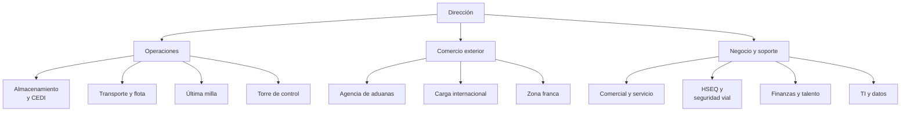
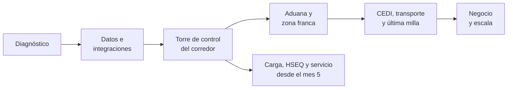
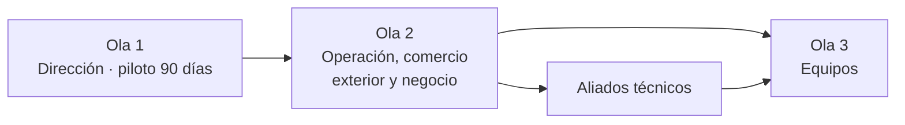

# Sector Logística, transporte y comercio exterior

Mismos principios, estructura y leyenda de la pestaña Principios y Tecnología (outsourcing); aquí el caso de referencia es un operador logístico integral con almacenamiento, transporte, aduanas, carga internacional y zona franca.

## Departamentos y roles

El operador se organiza en 11 departamentos agrupados en tres frentes. La IA rinde primero donde hay mucho documento y mucha excepción: aduanas, torre de control y servicio al cliente.

Operaciones mueve y guarda la carga, comercio exterior la hace cruzar fronteras, y negocio y soporte venden, protegen y sostienen el servicio.

| Departamento | Roles | Particularidad del sector |
| --- | --- | --- |
| Dirección | Gerente general, gerente de operaciones, gerente financiero | Márgenes estrechos y clientes que exigen visibilidad total |
| Almacenamiento y CEDI | Gerente de CEDI, jefe de bodega, analista de inventarios, operario | Requisitos distintos por cliente en un mismo almacén |
| Transporte y flota | Jefe de transporte, planeador de rutas, coordinador de flota, conductor | Flota propia y de terceros con costo por kilómetro al límite |
| Última milla | Coordinador de última milla, auxiliar de entregas | Miles de entregas diarias con novedades |
| Torre de control | Jefe de torre de control, analista de monitoreo | Excepciones que deben detectarse antes que el cliente |
| Agencia de aduanas | Director de aduanas, especialista en clasificación arancelaria, auxiliar | Responsabilidad legal sobre cada declaración |
| Carga internacional | Gerente de carga, pricing, coordinador de operaciones internacionales | Tarifas volátiles y documentos de embarque |
| Zona franca | Gerente de zona franca, jefe de inventario, analista | Inventario bajo control aduanero |
| Comercial y servicio | Gerente comercial, KAM, servicio al cliente | Licitaciones exigentes y seguimiento permanente de pedidos |
| HSEQ y seguridad vial | Coordinador HSEQ, líder de seguridad vial, analista de calidad | Accidentalidad vial, carga peligrosa y cadena de frío |
| Finanzas y talento | Analista financiero, facturación, gestión humana, formación | Rotación alta de operarios y conductores |
| TI y datos | Arquitecto, integrador EDI y APIs, analista de datos | Integraciones con los sistemas de cada cliente |

## Roles antes y después de la transformación

La transformación no elimina roles: cambia en qué emplea cada persona su tiempo. La tabla describe, para cada rol, cómo trabaja hoy en TransAndes, cómo trabajará cuando el Programa Corredor Pacífico esté en marcha y la productividad que se espera. En el modelo nuevo, la IA prepara, clasifica y alerta, pero no firma declaraciones, no decide la clasificación arancelaria definitiva ni autoriza mercancías peligrosas; esas decisiones siguen siendo del especialista o el responsable autorizado. Los datos de un cliente nunca se usan en beneficio de otro ni se muestran a otro, y el tiempo liberado de las personas no se cuenta como ahorro de nómina. Algunas rutas agrupan roles que hacen el mismo recorrido de cursos, como el especialista en clasificación arancelaria y el auxiliar de aduanas; aquí el especialista y el declarante aparecen por separado porque su trabajo cambia de forma distinta. Las cifras salen de las fichas de los cursos de cada rol y se miden contra la línea base de la persona antes del curso.

| Rol | Cómo trabaja hoy | Cómo trabajará después de la transformación | Potencial de productividad |
| --- | --- | --- | --- |
| Gerente general | Aprueba iniciativas digitales una por una y crece con los mismos servicios de transporte y almacenamiento. | Conduce el programa con una hoja de ruta en la que la IA no firma declaraciones ni autoriza mercancías peligrosas, y abre servicios nuevos, como la logística farmacéutica y de exportación. | Casos de uso con retorno medido en 12 meses: al menos 3. Ingresos de servicios nuevos: 10% a 15% del total en 24 meses. |
| Gerente de operaciones | Se entera de muchas excepciones cuando el cliente llama, y el OTIF del corredor es de 86%. | Dirige una torre de control con visibilidad del corredor y alertas, gobierna el uso de los datos de cada cliente y mide el nivel de servicio con la definición de cada contrato. | OTIF del corredor: de 86% a 94%. Aprobación de un uso nuevo de IA: −50%. |
| Gerente financiero | Recibe casos de negocio que cuentan como ahorro de nómina el tiempo liberado y conoce la rentabilidad solo en agregado. | Aprueba casos de negocio que miden el valor sin recortar personas y revisa la rentabilidad por cliente con el costo real de servirle. | Construcción de un caso de negocio: −50% a −70%. |
| Analista de costos logísticos | Reparte los costos por promedios, y los errores propios terminan cargados al costo de servir de un cliente. | Costea cada pedido y cada cliente por actividades, sin cargarle los costos de fallas de TransAndes. | Costeo por cliente: −50% a −70%. Costos de fallas propias cargados a un cliente: cero. |
| Gerente de CEDI | Define las ubicaciones del almacén por costumbre, y los operarios recorren distancias largas en cada pedido. | Rediseña el layout y las reglas de ubicación del WMS con Claude, sin juntar productos incompatibles ni sobrecargar los racks. | Recorrido por pedido: −20% a −30%. Reglas que juntan productos incompatibles o sobrecargan un nivel: cero. |
| Jefe de bodega | Mide la productividad por turno a ojo y fija metas iguales para todos. | Fija estándares por operario y turno con datos del WMS, con suplementos por fatiga y por trabajo en cámara fría. | Productividad de picking: +15% a +25%. Estándares sin suplementos por fatiga o cámara fría: cero. |
| Jefe de inventarios | Cuenta el inventario de cada cliente en conteos generales, con una exactitud de 94%. | Programa conteos cíclicos por cliente y ajusta el inventario solo con reconteo y la aprobación que exige cada contrato. | Exactitud de inventario: de 94% a 99%. Ajustes sin reconteo ni aprobación: cero. |
| Operario de bodega | Consulta los requisitos de cada cliente en carpetas o con el supervisor. | Consulta en el celular un asistente con los requisitos vigentes de cada cliente, que escala toda carga con sello roto o excursión de temperatura. | Errores por requisito de cliente: −40% a −60%. |
| Planeador de transporte | Planea los viajes a mano, y 28% de los kilómetros se recorren en vacío. | Planea la red nacional con consolidación de cargas y retornos, sin mezclar cargas incompatibles. | Kilómetros en vacío: de 28% a 18%–20%. Consolidaciones con cargas incompatibles: cero. |
| Jefe de tráfico | Asigna los viajes a vehículos propios y terceros con listas en hojas de cálculo. | Gestiona la flota con un tablero de costo por kilómetro y desempeño, y no asigna viajes a vehículos o conductores con documentos vencidos. | Costo por kilómetro: −5% a −10%. Viajes asignados con documentos o pólizas vencidos: cero. |
| Jefe de mantenimiento de flota | Mantiene la flota por calendario y atiende las fallas cuando el camión se detiene en ruta. | Anticipa las fallas con alertas desde la telemetría, con detención segura del vehículo ante una alerta crítica de frenos o llantas. | Fallas en ruta: −30% a −50%. Alertas críticas sin detención segura: cero. |
| Conductor de carga | Reporta documentos y novedades por llamada o mensaje, y el reporte llega tarde o incompleto. | Reporta documentos y novedades desde el celular con el vehículo detenido, con su plan de seguridad vial personal. | Reporte de una novedad: −60% a −80%. Interacciones con la aplicación con el vehículo en movimiento: cero. |
| Coordinador de última milla | Arma las rutas diarias a los tenderos a mano. | Rutea de forma dinámica, sin acumular efectivo por encima del límite de seguridad del vehículo. | Entregas por vehículo al día: +10% a +20%. Rutas que superan el límite de efectivo: cero. |
| Conductor de última milla | Registra la entrega en papel, y 12% de las entregas tiene alguna novedad. | Registra la prueba de entrega y cada novedad en el momento, con su causa real. | Entregas con novedad: de 12% a 6%. Novedades atribuidas al cliente cuando la causa fue la llegada tarde: cero. |
| Analista de logística inversa | Procesa las devoluciones a mano y sin un destino definido para cada una. | Clasifica cada devolución con su destino y reintegra los medicamentos solo con la liberación de calidad del cliente. | Procesamiento de una devolución: −40% a −60%. Medicamentos reintegrados sin liberación de calidad: cero. |
| Analista de torre de control | Revisa el estado de los envíos llamando a conductores y bodegas; detecta antes que el cliente solo 30% de las excepciones. | Atiende alertas de temperatura y desvío dentro del protocolo, y comunica cada excepción al cliente con hora confirmada y causa con evidencia. | Excepciones detectadas antes que el cliente: de 30% a 80%. Respuesta a una excepción: −40% a −60%. |
| Especialista en clasificación arancelaria | Clasifica cada mercancía consultando el arancel a mano, y 9% de las declaraciones requiere corrección. | Recibe una propuesta de clasificación con su fundamento, decide y documenta la clasificación definitiva. | Tiempo por clasificación: −40% a −60%. Declaraciones con correcciones: de 9% a 3%. |
| Declarante de aduanas | Arma los expedientes de nacionalización a mano, y el proceso toma 4 días. | Revisa y firma expedientes preparados con los documentos completos y verificados. | Nacionalización: de 4 a 2 días. Declaraciones transmitidas sin revisión y firma del declarante: cero. |
| Especialista de comercio exterior | Analiza los beneficios de los tratados de libre comercio caso por caso. | Analiza con Claude los regímenes y tratados de cada exportación, y solo emite certificados de origen para productos que cumplen la regla. | Análisis de beneficios arancelarios: −60% a −80%. Certificados de origen para productos que no cumplen la regla: cero. |
| Director de aduanas | Prepara la validación como Operador Económico Autorizado reuniendo evidencia a mano. | Mantiene los requisitos del Operador Económico Autorizado con evidencia al día y la evaluación de seguridad vigente de cada asociado. | Preparación de la validación: −50%. Asociados sin evaluación de seguridad vigente: cero. |
| Ejecutivo de carga internacional | Cotiza cada embarque buscando tarifas en correos y hojas de cálculo. | Cotiza en minutos con un modelo de tarifas vigentes, con su vigencia y sus exclusiones declaradas. | Tiempo por cotización: −60% a −80%. Cotizaciones con tarifas vencidas: cero. |
| Coordinador de embarques | Hace el seguimiento de cada embarque y sus documentos con llamadas y correos. | Sigue los embarques con los documentos al día y confirma cualquier cambio de consignatario por un canal verificado. | Embarques demorados por documentos: −50%. Cambios de datos críticos sin confirmación del cliente: cero. |
| Gerente de carga internacional | Recomienda el Incoterm por costumbre, y surgen disputas por las responsabilidades del embarque. | Recomienda el Incoterm con una guía por cliente que asigna al vendedor solo lo que puede cumplir. | Disputas por responsabilidades del embarque: −50%. |
| Gerente de zona franca | Controla el ingreso y la salida de mercancía con formularios manuales. | Opera el ingreso y la salida con controles en el sistema y prepara servicios de valor agregado, como el acondicionamiento para Vitalia. | Ingreso y salida de mercancía: −30% a −50%. Salidas sin formulario autorizado: cero. |
| Jefe de inventario de zona franca | Concilia el inventario bajo control aduanero con diferencias que quedan sin explicar. | Concilia con la autoridad cada mes, con las diferencias explicadas y los ajustes por el procedimiento autorizado. | Diferencias sin explicar en la conciliación: −70%. Ajustes sin el procedimiento autorizado: cero. |
| Ingeniero de soluciones | Arma cada propuesta y cada respuesta a licitación desde cero. | Diseña soluciones con Claude y compromete solo los niveles de servicio que la operación puede demostrar. | Preparación de una propuesta: −50%. Niveles de servicio comprometidos sin evidencia: cero. |
| Gerente comercial | Fija las tarifas por negociación, sin conocer el margen real de cada cliente. | Ajusta las tarifas con la rentabilidad por cliente y dentro de la cláusula de revisión de cada contrato. | Análisis de rentabilidad: −50% a −70%. Ajustes fuera de la cláusula de revisión: cero. |
| Gerente de cuenta clave | Prepara los planes de cuenta con información dispersa. | Construye el plan anual de cada cuenta, como la de Cordillera, solo con información de ese cliente. | Ingresos por cuenta clave: +10% a +15% en 12 meses. Planes que usan información de otro cliente: cero. |
| Analista de servicio al cliente | Responde a mano cada consulta sobre el estado de los pedidos. | Supervisa un asistente que resuelve las consultas de pedidos a quien verificó ser su titular, y atiende los casos escalados. | Consultas de pedidos resueltas sin escalar: 50% a 70%. Información de un pedido dada a quien no es su titular: cero. |
| Coordinador de seguridad vial | Revisa los incidentes viales después de que ocurren. | Analiza la telemetría por conductor y construye planes de mejora; las sanciones pasan siempre por revisión humana. | Accidentes viales: −30% en 12 meses. Sanciones aplicadas automáticamente desde la telemetría: cero. |
| Coordinador de mercancías peligrosas y cadena de frío | Revisa los registros de temperatura y la documentación de mercancías peligrosas después del envío. | Aplica protocolos para Vitalia con monitoreo durante el envío, y autoriza cada despacho de mercancías peligrosas. | Excursiones de temperatura: −50%. Despachos de mercancías peligrosas sin autorización: cero. |
| Coordinador de calidad | Prepara las auditorías de ISO 9001 y BASC reuniendo evidencia a mano. | Mantiene una matriz de requisitos con evidencia real, revisada y aprobada. | Hallazgos en auditoría externa: −50%. Evidencias generadas sin que el hecho haya ocurrido: cero. |
| Analista de facturación | Factura los servicios con cierres largos y recibe reclamos por cobros incorrectos. | Factura conciliando cada cobro con la operación, sin cobrar al cliente reentregas causadas por fallas propias. | Reclamos de facturación: −50%. Cierre de facturación: −40%. |
| Gerente de talento humano | Comunica los cambios por circular, sin explicar qué se mide de cada persona. | Acompaña el programa con un plan de cambio para CEDI y flota que explica qué datos se miden de cada persona y para qué. | Adopción en 90 días: 70%. Mensajes que omiten qué datos se miden y para qué: cero. |
| Coordinador de formación | Forma a los operarios y conductores nuevos al lado de un compañero. | Forma con una matriz de competencias y un módulo móvil, con certificación práctica para montacargas y mercancías peligrosas. | Inducción de un operario nuevo: −30% a −50%. Personas asignadas sin certificación práctica vigente: cero. |
| Arquitecto de integraciones | Integra a cada cliente con desarrollos a la medida y archivos planos. | Integra a los clientes por EDI y API, con cada pedido validado por el cliente. | Integración de un cliente nuevo: −40% a −60%. Pedidos duplicados o alterados sin validación: cero. |
| Desarrollador de integraciones | Exporta datos del WMS, el TMS y la aduana para cada consulta. | Construye servidores MCP de solo lectura que solo devuelven datos de un cliente a quien está autorizado para él. | Conexión de un sistema a la IA: −50% a −70%. Datos de un cliente devueltos a quien no está autorizado: cero. |
| Analista de datos | Arma el informe mensual del corredor en hojas de cálculo. | Construye el modelo de datos del corredor y tableros por cliente que solo reciben los datos de ese cliente. | Preparación del informe mensual: −50% a −70%. Tableros que reciben datos de otros clientes: cero. |
| Oficial de seguridad de la información | Revisa los accesos a los sistemas de forma esporádica. | Evalúa los riesgos de los sistemas y revoca los accesos de personas retiradas o terceros el día de su salida. | Evaluación de riesgos: −40%. Accesos vigentes después del día de salida: cero. |

## Caso de referencia: Programa Corredor Pacífico

El profesor desarrolla un único proyecto para todo el sector: TransAndes Logística, operador ficticio, digitaliza el corredor que va del puerto a sus clientes, pasando por aduana, zona franca, CEDI y última milla.

TransAndes tiene tres CEDI, 400 camiones propios y de terceros, una agencia de aduanas, una zona franca y un equipo de carga internacional. Sus clientes principales son los otros casos del catálogo: exporta galletas de Alimentos Cordillera, mueve medicamentos de Vitalia con cadena de frío, distribuye a los tenderos de Distribuidora Andina y lleva el concentrado de Altiplano Sur al puerto.

| Componente | Qué entrega |
| --- | --- |
| Torre de control | Visibilidad del corredor con alertas de excepción |
| Aduana ágil | Expedientes completos para la firma del declarante y clasificación arancelaria asistida, con decisión del especialista |
| CEDI productivo | Ubicaciones optimizadas, picking medido e inventario exacto |
| Transporte optimizado | Rutas consolidadas, flota disponible y transportadores medidos |
| Última milla | Ruteo diario y prueba de entrega a tenderos |
| Servicio al cliente | Asistente de seguimiento de pedidos con escalamiento |

En logística rige una regla fija: la IA prepara, clasifica y propone, pero no firma declaraciones aduaneras, no decide la clasificación arancelaria definitiva ni autoriza el despacho de mercancías peligrosas; eso lo hace la persona responsable. El proyecto de referencia usa datos sintéticos.

El caso completo, con la situación actual de TransAndes, las fases del programa, el modelo operativo de 2027 y el modelo instruccional, está en Caso de referencia · Logística. Cada curso tiene su ficha ampliada en Fichas de cursos · Logística.

## Tronco común del sector

Cinco cursos de base cuyos proyectos son la fase 0 de todas las rutas. Para operarios y conductores se dictan en el celular, en bloques cortos.

| Código | Curso | Capa | Proyecto de referencia | Capacidades | Aceleración esperada |
| --- | --- | --- | --- | --- | --- |
| LOG-TRC-01 | IA generativa en logística y comercio exterior: uso seguro y datos de clientes | Todas | Política de uso de IA de TransAndes: datos de clientes y de carga, y decisiones siempre humanas | Proyectos | Documentos de clientes fuera de herramientas aprobadas: meta cero |
| LOG-TRC-02 | Productividad con Claude en Excel, PowerPoint y correo | Dirección, líderes, equipos | Reporte semanal del área generado desde sus propios datos | Claude en Excel, Claude en PowerPoint | Reporte semanal: −60% a −80% |
| LOG-TRC-03 | Procedimientos y requisitos de clientes como documentación viva | Todas | Procedimientos del corredor y matriz de requisitos por cliente | Docs, skills | Errores por requisito incumplido: −50% |
| LOG-TRC-04 | Análisis de datos logísticos para no analistas | Líderes, equipos | Análisis de un año de pedidos, tiempos y novedades del corredor | Claude en Excel | Análisis de datos: −50% a −70% |
| LOG-TRC-05 | Gestión de riesgos en la cadena de suministro (BASC y OEA) | Líderes, aliado técnico | Matriz de riesgos de seguridad del corredor | Docs | Actualizar la matriz: −50% |

## Cursos por departamento y rol

43 cursos de rol sobre el tronco común, cada uno con su proyecto de referencia dentro del Programa Corredor Pacífico.

### Dirección

| Código | Curso | Roles | Proyecto de referencia | Capacidades | Aceleración esperada |
| --- | --- | --- | --- | --- | --- |
| LOG-DIR-01 | Estrategia de transformación digital e IA en logística | Gerente general | Hoja de ruta del Programa Corredor Pacífico | Investigación con citas, Docs | Al menos 3 casos de uso con retorno en 12 meses |
| LOG-DIR-02 | Caso de negocio de la IA en operaciones logísticas | Gerente general, gerente financiero | Caso de negocio del piloto para la junta | Claude en Excel | Caso de negocio: −50% a −70% de tiempo |
| LOG-DIR-03 | Gobierno de IA y datos compartidos con clientes | Gerente de operaciones | Marco de gobierno: datos de clientes, permisos y límites de la IA | Docs | Aprobar un uso nuevo de IA: −50% |
| LOG-DIR-04 | Nuevos servicios logísticos y expansión | Gerente general | Portafolio de servicios nuevos (logística farmacéutica y de exportación) que protege las cuentas actuales | Investigación con citas, Claude en Excel | Servicios nuevos: 10% a 15% de ingresos en 24 meses |

### Almacenamiento y CEDI

| Código | Curso | Roles | Proyecto de referencia | Capacidades | Aceleración esperada |
| --- | --- | --- | --- | --- | --- |
| LOG-CED-01 | Operación de centros de distribución y WMS | Gerente de CEDI | Layout y reglas de ubicación (slotting) del CEDI principal | Claude en Excel, artefactos | Recorrido por pedido: −20% a −30% |
| LOG-CED-02 | Productividad de almacén y picking | Gerente de CEDI, jefe de bodega | Estándares de picking con análisis de productividad por operario y turno | Claude en Excel | Productividad de picking: +15% a +25% |
| LOG-CED-03 | Control de inventarios y exactitud | Analista de inventarios, jefe de bodega | Programa de conteo cíclico y exactitud por cliente | Claude en Excel | Exactitud: de 94% a 99% |
| LOG-CED-04 | Asistente de bodega para operarios | Operario de bodega | Asistente con procedimientos y requisitos de cada cliente | Skills | Errores por requisito: −40% a −60% |

### Transporte y flota

| Código | Curso | Roles | Proyecto de referencia | Capacidades | Aceleración esperada |
| --- | --- | --- | --- | --- | --- |
| LOG-TRA-01 | Planeación y optimización de rutas de carga | Planeador de rutas, jefe de transporte | Plan nacional de rutas con consolidación de carga | Claude Code, Claude en Excel | Km en vacío: de 28% a 18–20% |
| LOG-TRA-02 | Gestión de flota propia y tercerizada | Coordinador de flota, jefe de transporte | Tablero de costo por kilómetro y desempeño de transportadores | Artefactos, Claude en Excel | Costo por km: −5% a −10% |
| LOG-TRA-03 | Mantenimiento predictivo de flota | Jefe de transporte, líder de seguridad vial | Alertas de falla de camiones desde telemetría | Claude Code | Fallas en ruta: −30% a −50% |
| LOG-TRA-04 | Conductor conectado: documentos y novedades | Conductor | App de documentos de viaje y reporte de novedades | Artefactos | Reporte de una novedad: −60% a −80% |

### Última milla

| Código | Curso | Roles | Proyecto de referencia | Capacidades | Aceleración esperada |
| --- | --- | --- | --- | --- | --- |
| LOG-UMI-01 | Ruteo dinámico de última milla | Coordinador de última milla | Ruteo diario de entregas a los tenderos de Andina | Claude Code | Entregas por vehículo: +10% a +20% |
| LOG-UMI-02 | Prueba de entrega y gestión de novedades | Coordinador de última milla, auxiliar de entregas | Flujo de prueba de entrega con novedades clasificadas | Artefactos, skills | Entregas con novedad: de 12% a 6% |
| LOG-UMI-03 | Logística inversa y devoluciones | Coordinador de última milla, auxiliar de entregas | Proceso de devoluciones con clasificación y destino | Docs, Claude en Excel | Procesar una devolución: −40% a −60% |

### Torre de control

| Código | Curso | Roles | Proyecto de referencia | Capacidades | Aceleración esperada |
| --- | --- | --- | --- | --- | --- |
| LOG-TCT-01 | Torre de control logística con IA | Jefe de torre de control, analista de monitoreo | Tablero de visibilidad del corredor con alertas de excepción | Artefactos, MCP | Excepciones anticipadas: de 30% a 80% |
| LOG-TCT-02 | Gestión de excepciones y comunicación al cliente | Analista de monitoreo | Protocolo de excepciones con mensajes aprobados para cada cliente | Skills | Respuesta a una excepción: −40% a −60% |
| LOG-TCT-03 | Indicadores de nivel de servicio (OTIF) | Jefe de torre de control, gerente de operaciones | Tablero OTIF por cliente con causas de incumplimiento | Claude en Excel, artefactos | OTIF: de 86% a 94% |

### Agencia de aduanas

| Código | Curso | Roles | Proyecto de referencia | Capacidades | Aceleración esperada |
| --- | --- | --- | --- | --- | --- |
| LOG-ADU-01 | Clasificación arancelaria asistida por IA | Especialista en clasificación arancelaria | Propuestas de clasificación con fundamento; decide el especialista | Proyectos, investigación con citas | Correcciones en declaraciones: de 9% a 3% |
| LOG-ADU-02 | Declaraciones y documentación aduanera | Auxiliar de aduanas, director de aduanas | Expediente de importación completo para revisión y firma del declarante | Skills, Docs | Nacionalización: de 4 a 2 días |
| LOG-ADU-03 | Regímenes aduaneros y tratados de libre comercio | Especialista en clasificación arancelaria | Beneficios arancelarios disponibles para las exportaciones de Cordillera | Investigación con citas | Análisis de beneficios: −60% a −80% |
| LOG-ADU-04 | Operador Económico Autorizado y cumplimiento aduanero | Director de aduanas | Matriz de requisitos OEA con evidencia por requisito | Docs, Claude en Excel | Preparación de la validación OEA: −50% |

### Carga internacional

| Código | Curso | Roles | Proyecto de referencia | Capacidades | Aceleración esperada |
| --- | --- | --- | --- | --- | --- |
| LOG-CAR-01 | Cotización y pricing de carga internacional | Pricing, gerente de carga | Modelo de cotización marítima y aérea | Claude en Excel | Tiempo por cotización: −60% a −80% |
| LOG-CAR-02 | Coordinación de embarques y documentos de transporte | Coordinador de operaciones internacionales | Seguimiento de embarques con BL, AWB y documentos al día | Docs, MCP | Embarques demorados por documentos: −50% |
| LOG-CAR-03 | Incoterms y gestión de riesgos del embarque | Gerente de carga | Guía de Incoterms aplicada a las exportaciones de Cordillera | Docs | Disputas por responsabilidades: −50% |

### Zona franca

| Código | Curso | Roles | Proyecto de referencia | Capacidades | Aceleración esperada |
| --- | --- | --- | --- | --- | --- |
| LOG-ZFR-01 | Operación de zona franca y depósitos | Gerente de zona franca | Proceso de ingreso y salida de mercancía con controles | Docs | Ingreso y salida: −30% a −50% de tiempo |
| LOG-ZFR-02 | Inventarios bajo control aduanero | Jefe de inventario, analista | Conciliación del inventario con los registros ante la autoridad | Claude en Excel | Diferencias sin explicar: −70% |
| LOG-ZFR-03 | Servicios de valor agregado | Gerente de zona franca | Propuesta de acondicionamiento para Vitalia dentro de sus requisitos sanitarios | Docs, Claude en Excel | Preparar una propuesta: −50% |

### Comercial y servicio

| Código | Curso | Roles | Proyecto de referencia | Capacidades | Aceleración esperada |
| --- | --- | --- | --- | --- | --- |
| LOG-COM-01 | Diseño de soluciones logísticas y licitaciones | Gerente comercial | Propuesta logística completa para un cliente nuevo | Docs, Claude en PowerPoint | Preparar una propuesta: −50% |
| LOG-COM-02 | Pricing y rentabilidad por cliente | Gerente comercial, analista financiero | Matriz de tarifas y margen por cliente y servicio | Claude en Excel | Análisis de rentabilidad: −50% a −70% |
| LOG-COM-03 | Servicio al cliente con agentes de IA | Servicio al cliente | Asistente de seguimiento de pedidos con escalamiento a una persona | MCP, skills | Consultas resueltas sin escalar: 50% a 70% |
| LOG-COM-04 | Gestión de cuentas clave (KAM) | KAM | Plan de cuenta de Alimentos Cordillera | Docs, Claude en PowerPoint | Ingresos por cuenta clave: +10% a +15% |

### HSEQ y seguridad vial

| Código | Curso | Roles | Proyecto de referencia | Capacidades | Aceleración esperada |
| --- | --- | --- | --- | --- | --- |
| LOG-HSQ-01 | Seguridad vial y gestión de conductores | Líder de seguridad vial, conductor | Análisis de telemetría y plan de seguridad vial por conductor | Claude en Excel | Accidentes viales: −30% |
| LOG-HSQ-02 | Mercancías peligrosas y cadena de frío | Coordinador HSEQ | Protocolo de transporte de medicamentos de Vitalia con registros de temperatura | Docs, Claude en Excel | Excursiones de temperatura: −50% |
| LOG-HSQ-03 | Sistemas de gestión y certificaciones (ISO 9001, BASC) | Coordinador HSEQ, analista de calidad | Matriz de requisitos con evidencia por requisito | Docs | Hallazgos en auditoría: −50% |

### Finanzas y talento

| Código | Curso | Roles | Proyecto de referencia | Capacidades | Aceleración esperada |
| --- | --- | --- | --- | --- | --- |
| LOG-ADM-01 | Costeo logístico (ABC) | Analista financiero, gerente financiero | Costo por pedido y por cliente | Claude en Excel | Costeo por cliente: −50% a −70% de tiempo |
| LOG-ADM-02 | Facturación y conciliación con clientes | Facturación | Facturación de servicios con conciliación automática contra operación | Claude en Excel | Reclamos de facturación: −50% |
| LOG-ADM-03 | Gestión del cambio en operaciones logísticas | Gestión humana | Plan de cambio para CEDI y flota | Docs | Adopción en 90 días: meta 70% |
| LOG-ADM-04 | Formación de operarios y conductores | Formación | Matriz de competencias y plan de formación móvil | Claude en Excel, artefactos | Inducción de un operario: −30% a −50% |

### TI y datos

| Código | Curso | Roles | Proyecto de referencia | Capacidades | Aceleración esperada |
| --- | --- | --- | --- | --- | --- |
| LOG-TIC-01 | Integración con clientes (EDI y APIs) | Integrador EDI y APIs | Integración de pedidos con Cordillera y Andina | Claude Code | Integrar un cliente nuevo: −40% a −60% |
| LOG-TIC-02 | Servidores MCP para sistemas logísticos | Arquitecto | Servidor MCP de solo lectura sobre WMS, TMS y sistema aduanero | MCP, Claude Code | Conectar un sistema a la IA: −50% a −70% |
| LOG-TIC-03 | Analítica logística y tableros | Analista de datos | Modelo de datos del corredor con sus tableros | Claude Code, artefactos | Informe mensual: −50% a −70% |
| LOG-TIC-04 | Ciberseguridad y protección de datos de carga | Arquitecto | Evaluación de riesgos y controles de acceso a datos de clientes | Docs | Evaluación de riesgos: −40% de tiempo |

## Rutas por rol y orden de despliegue

Cada ruta es un macroproyecto dentro del Programa Corredor Pacífico, y sus cursos son las fases en el orden en que el programa las necesita.

La torre de control abre la ola 2: sin visibilidad del corredor, las mejoras de cada eslabón no se pueden medir.

Operarios, conductores y auxiliares tienen rutas de mayor especialización, no de salida: la meta es que cada persona atienda más carga con menos errores. La fase 0 es el bloque del tronco común; los códigos omiten el prefijo LOG-.

| Rol | Ola | Macroproyecto en el Programa Corredor Pacífico | Fase 0 (tronco) | Fases 1 → n |
| --- | --- | --- | --- | --- |
| Gerente general | 1 | Programa aprobado con nuevos servicios | TRC-01, 02 | DIR-01 → DIR-02 → DIR-04 |
| Gerente de operaciones | 1 | Corredor visible y medido | TRC-01, 02, 04 | DIR-03 → TCT-01 → TCT-03 |
| Gerente financiero | 1 | Costo y margen por cliente conocidos | TRC-01, 02 | DIR-02 → ADM-01 → COM-02 |
| Jefe de torre de control | 2 | Cada excepción detectada y comunicada a tiempo | TRC-01 a 05 | TCT-01 → TCT-02 → TCT-03 |
| Gerente de CEDI | 2 | CEDI productivo y exacto | TRC-01 a 05 | CED-01 → CED-02 → CED-03 |
| Jefe de transporte | 2 | Flota rentable y disponible | TRC-01 a 05 | TRA-01 → TRA-02 → TRA-03 |
| Coordinador de última milla | 2 | Entregas a tenderos sin novedades | TRC-01, 02, 04 | UMI-01 → UMI-02 → UMI-03 |
| Director de aduanas | 2 | Aduana ágil y cumplida | TRC-01, 03, 05 | ADU-01 → ADU-02 → ADU-04 |
| Gerente de carga internacional | 2 | Exportaciones de Cordillera coordinadas puerta a puerta | TRC-01, 02, 04 | CAR-03 → CAR-01 → CAR-02 |
| Gerente de zona franca | 2 | Zona franca con inventario conciliado y servicios nuevos | TRC-01, 03, 05 | ZFR-01 → ZFR-02 → ZFR-03 |
| Gerente comercial | 2 | Cuentas rentables y nuevos clientes | TRC-01, 02, 04 | COM-01 → COM-02 → COM-04 |
| Coordinador HSEQ | 2 | Operación segura, certificada y con cadena de frío | TRC-01 a 05 | HSQ-03 → HSQ-01 → HSQ-02 |
| Gestión humana y formación | 2 | Operarios y conductores preparados | TRC-01 a 03 | ADM-04 → ADM-03 |
| Arquitecto, integrador EDI y APIs | Aliado | Clientes y sistemas conectados de forma segura | TRC-01 a 05 | TIC-01 → TIC-04 → TIC-02 |
| Analista de datos | Aliado | Datos del corredor en un solo modelo | TRC-01 a 05 | TCT-03 → TIC-03 |
| Jefe de bodega, analista de inventarios | 3 | Inventario exacto y picking productivo | TRC-01, 03, 04 | CED-03 → CED-02 |
| Operario de bodega | 3 | Trabajo con los requisitos de cada cliente a la mano | TRC-01, 03 | CED-04 |
| Planeador de rutas, coordinador de flota | 3 | Rutas consolidadas y transportadores medidos | TRC-01, 02, 04 | TRA-01 → TRA-02 |
| Conductor | 3 | Viajes documentados y conducción segura | TRC-01, 03 | TRA-04 → HSQ-01 |
| Auxiliar de entregas | 3 | Entregas probadas y devoluciones ordenadas | TRC-01, 03 | UMI-02 → UMI-03 |
| Analista de monitoreo | 3 | Alertas atendidas y clientes informados | TRC-01, 03, 04 | TCT-01 → TCT-02 |
| Especialista en clasificación, auxiliar de aduanas | 3 | Expedientes aduaneros completos y bien clasificados | TRC-01, 03 | ADU-01 → ADU-02 → ADU-03 |
| Pricing, coordinador de operaciones internacionales | 3 | Embarques cotizados y seguidos | TRC-01, 02, 04 | CAR-01 → CAR-02 |
| Servicio al cliente, KAM | 3 | Clientes atendidos al instante y cuentas que crecen | TRC-01, 02 | COM-03 → COM-04 |
| Analista financiero, facturación | 3 | Del costo a la factura sin diferencias | TRC-01, 02, 04 | ADM-01 → ADM-02 |
| Líder de seguridad vial | 3 | Seguridad vial basada en datos | TRC-01, 05 | HSQ-01 → TRA-03 |

Detalle de cada ruta, fase por fase y con su entregable integral: Rutas por rol · Logística
