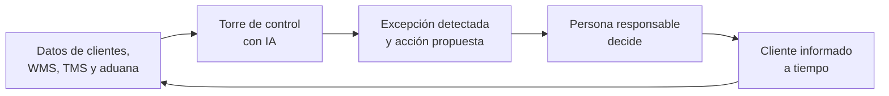

# Caso de referencia · Logística

El caso tiene dos funciones. Es el proyecto que el profesor construye y sobre el que se diseñan todos los cursos y rutas del sector. Y es la imagen de cómo operará un operador logístico integral cuando termine su transformación. Las empresas y cifras son ficticias, y el proyecto usa datos sintéticos.

## TransAndes Logística hoy

TransAndes tiene tres CEDI, 400 camiones propios y de terceros, una agencia de aduanas, una zona franca y un equipo de carga internacional. Sus clientes principales son los otros casos del catálogo: exporta galletas de Alimentos Cordillera, mueve medicamentos de Vitalia con cadena de frío, distribuye a los tenderos de Distribuidora Andina y lleva el concentrado de Altiplano Sur al puerto. Trabaja con márgenes estrechos y con clientes que quieren saber dónde está cada pedido en todo momento.

| Indicador | Situación actual |
| --- | --- |
| Entregas completas y a tiempo (OTIF) del corredor | 86% |
| Excepciones detectadas antes que el cliente | 30% |
| Tiempo de nacionalización | 4 días |
| Declaraciones aduaneras con correcciones | 9% |
| Exactitud de inventario en los CEDI | 94% |
| Productividad de picking | Sin estándar por operario |
| Kilómetros en vacío de la flota | 28% |
| Entregas a tenderos con novedad | 12% |
| Llamadas al servicio al cliente preguntando por un pedido | 60% del total |
| Uso de IA | Sin reglas; documentos de clientes copiados a herramientas públicas |

El diagnóstico que abre el programa tiene tres hallazgos: nadie ve el corredor completo, así que las excepciones se descubren cuando el cliente llama; la aduana pierde días por expedientes incompletos; y los datos de los clientes circulan sin control.

## El Programa Corredor Pacífico

El piloto digitaliza el corredor que va del puerto a los clientes, pasando por aduana, zona franca, CEDI y última milla. Lo dirige un comité formado por el gerente general, el gerente de operaciones y el gerente financiero. La torre de control abre la segunda ola, con los líderes de CEDI, transporte, aduanas, carga, zona franca, comercial y HSEQ, y dos aliados técnicos: integraciones y datos.

| Componente | Qué entrega |
| --- | --- |
| Torre de control | Visibilidad del corredor con alertas de excepción |
| Aduana ágil | Expedientes completos para la firma del declarante y clasificación arancelaria asistida, con decisión del especialista |
| CEDI productivo | Ubicaciones optimizadas, picking medido e inventario exacto |
| Transporte optimizado | Rutas consolidadas, flota disponible y transportadores medidos |
| Última milla | Ruteo diario y prueba de entrega a tenderos |
| Servicio al cliente | Asistente de seguimiento de pedidos con escalamiento |

| Fase del programa | Duración | Entregable principal | Cursos que producen la fase |
| --- | --- | --- | --- |
| 1. Diagnóstico, caso y gobierno | 6 semanas | Hoja de ruta, caso de negocio y gobierno de datos de clientes | DIR-01 a DIR-03 |
| 2. Datos e integraciones | 8 semanas | Seguridad, integración con Cordillera y Andina y MCP | TIC-01, TIC-02, TIC-04 |
| 3. Torre de control y conductor conectado | 8 semanas | Aplicación del conductor, visibilidad del corredor y protocolo de excepciones | TRA-04, TCT-01, TCT-02 |
| 4. Aduana y zona franca | 12 semanas | OEA, clasificación, expedientes, tratados, operación e inventario de zona franca | ADU-01 a ADU-04, ZFR-01 a ZFR-03 |
| 5. CEDI, transporte, última milla y nivel de servicio | 16 semanas | Slotting, picking, inventario, asistente de bodega, rutas, flota, predictivo, ruteo, prueba de entrega, devoluciones, OTIF y modelo de datos | CED-01 a CED-04, TRA-01 a TRA-03, UMI-01 a UMI-03, TCT-03, TIC-03 |
| 6. Carga, HSEQ y servicio | Desde el mes 5 | Cotización, embarques, Incoterms, seguridad vial, cadena de frío, certificaciones y asistente de servicio | CAR-01 a CAR-03, HSQ-01 a HSQ-03, COM-03 |
| 7. Negocio y escala | Continua | Costeo, facturación, soluciones, pricing, cuentas clave, formación, plan de cambio y nuevos servicios | ADM-01 a ADM-04, COM-01, COM-02, COM-04, DIR-04 |

El tronco común (TRC-01 a TRC-05) se dicta a todos antes de su primera fase. Ningún documento de un cliente entra a una herramienta de IA antes de que TRC-01 esté aprobado.

## TransAndes 2027: cómo operará

En 2027, TransAndes avisa al cliente antes de que el cliente pregunte. La IA arma expedientes, propone clasificaciones, rutas y ubicaciones, y detecta excepciones; la firma de cada declaración y cada decisión sobre mercancías peligrosas sigue siendo de la persona responsable. Operarios, conductores y auxiliares atienden más carga con menos errores, y ninguno tiene ruta de salida.

Cada excepción resuelta deja una causa registrada, y esas causas vuelven como mejoras al corredor.

| Proceso | Hoy | En 2027 | Quién decide |
| --- | --- | --- | --- |
| Visibilidad | El cliente llama para preguntar | Torre de control con alertas antes del incumplimiento | El analista de monitoreo decide la acción |
| Aduana | Expedientes con faltantes | Expediente completo y clasificación propuesta con fundamento | El especialista clasifica y el declarante firma |
| Zona franca | Conciliación manual | Inventario conciliado con los registros ante la autoridad | El jefe de inventario firma |
| CEDI | Ubicaciones por costumbre | Slotting por rotación y picking medido | El gerente de CEDI aprueba |
| Transporte | Rutas por experiencia | Rutas consolidadas y flota con alertas de falla | El planeador aprueba |
| Última milla | Novedades sin clasificar | Ruteo diario y prueba de entrega | El coordinador ajusta |
| Servicio | ¿Dónde está mi pedido?, por teléfono | Asistente con estado en tiempo real y escalamiento | El agente resuelve lo escalado |
| Mercancías peligrosas y frío | Registros en papel | Protocolos con registros de temperatura | El coordinador HSEQ autoriza |
| Comercial | Tarifas sin costo real | Pricing con costo por pedido y por cliente | El gerente comercial decide |
| Datos de clientes | Copiados a herramientas públicas | Integraciones seguras y MCP de solo lectura | El arquitecto aprueba cada acceso |

La regla del sector se mantiene en todo el modelo: la IA prepara, clasifica y propone, pero no firma declaraciones aduaneras, no decide la clasificación arancelaria definitiva ni autoriza el despacho de mercancías peligrosas.

## El caso como eje del diseño instruccional

Antes de lanzar el catálogo, el profesor construye el Programa Corredor Pacífico completo. Cada curso enseña una fase del programa y cada ruta recorre las fases que su rol necesita.

**El expediente de referencia.** Una carpeta con datos sintéticos: un año de pedidos, tiempos y novedades del corredor, inventarios y movimientos de los tres CEDI, viajes y telemetría de la flota, entregas a tenderos, declaraciones aduaneras, documentos de embarque, registros de zona franca, contratos y tarifas de clientes, y conversaciones de servicio al cliente. Está organizada por fases, y cada entregable que produce un curso queda como insumo de los cursos que lo usan después. También guarda las conversaciones con Claude que el profesor tuvo para construir cada pieza.

**El modelo instruccional.** Todos los cursos siguen los mismos cinco momentos:

| Momento | Qué ocurre | Contenido de la clase | Peso |
| --- | --- | --- | --- |
| 1. Contexto | El participante recibe la fase del programa y el requisito que aplica | Lectura | 10% |
| 2. Demostración | El profesor construye el entregable del curso con Claude sobre el caso | Procedimiento práctico | 25% |
| 3. Réplica con ajuste | El estudiante repite el procedimiento con un ajuste (otro cliente, otra ruta, otro producto) | Actividad | 25% |
| 4. Réplica en la empresa | El estudiante aplica el procedimiento a un proceso real de su empresa | Actividad | 30% |
| 5. Evaluación por evidencia | Entregable, rúbrica y registro de la sesión con IA | Actividad de la última clase | 10% |

**Datos de clientes.** La réplica en la propia empresa usa datos anonimizados o autorizados por el cliente, según la política de TRC-01. Ningún entregable reemplaza la firma del declarante ni la autorización de HSEQ.

**Formato móvil.** Para operarios, conductores y auxiliares, cada clase se dicta en el celular y en bloques cortos.

**La medición.** Antes del curso, cada participante mide su tarea objetivo (un expediente, un ruteo, un conteo). Al terminar la réplica vuelve a medirla. La diferencia es el indicador de aceleración de su ficha.

## Metas del programa

| Indicador | Hoy | Meta a 12 meses |
| --- | --- | --- |
| OTIF del corredor | 86% | 94% |
| Excepciones detectadas antes que el cliente | 30% | 80% |
| Tiempo de nacionalización | 4 días | 2 días |
| Declaraciones con correcciones | 9% | 3% |
| Exactitud de inventario | 94% | 99% |
| Productividad de picking | Sin estándar | +15% a +25% sobre la línea base |
| Kilómetros en vacío | 28% | 18% a 20% |
| Entregas a tenderos con novedad | 12% | 6% |
| Consultas de pedidos resueltas por el asistente | Ninguna | 50% a 70% |
| Accidentes viales | Línea base del año | −30% |
| Documentos de clientes fuera de herramientas aprobadas | Frecuente | Cero |

## Cómo leer los indicadores

Los porcentajes de las fichas y las rutas son metas de diseño, no promesas. Son rangos razonables para operadores que adoptan el método con sus controles, y varían con la mezcla de clientes, la calidad de las integraciones, los sistemas de partida y la normativa aduanera de cada país. Cada empresa los confirma con su propia línea base: la misma tarea o el mismo indicador, medido antes y después, en el mismo proceso.

Se expresan como reducción del tiempo o de la pérdida (por ejemplo, −30% a −50%) o como mejora de un indicador (por ejemplo, de 86% a 94%). Un indicador sin línea base no se reporta.
